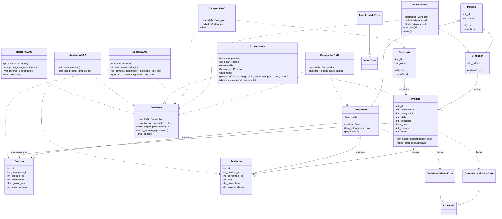

# Diagrama de Classes (UML) - Mercado Livrão

Cole o código abaixo em https://mermaid.live para ver e exportar como imagem.

## Observações

- `vendedor_id` e `categoria_id` em Produto podem ser nulos (um produto pode não ter vendedor ou categoria). Isso permite mostrar o FULL JOIN entre vendedores e produtos.
- Os atributos das classes são protegidos (`_nome`, `_saldo`...) e acessados por `@property`; os setters validam o valor e lançam `DadoInvalidoError`.
- `Comprador` e `Vendedor` herdam de `Pessoa`.
- As rotas Flask (`app.py`) usam as classes e os DAOs acima e tratam as exceções com `try/except`.
